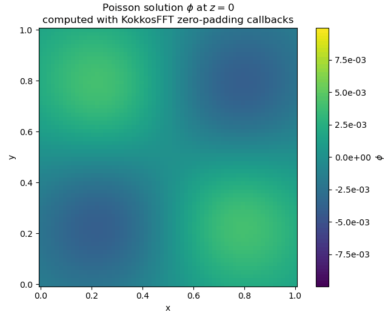

.. SPDX-FileCopyrightText: (C) The Kokkos-FFT development team, see COPYRIGHT.md file
..
.. SPDX-License-Identifier: MIT OR Apache-2.0 WITH LLVM-exception

.. _11_Callback:

3D Poisson equation with zero-padding callbacks
================================================

The animation above sweeps along ``z`` through the solution of the 3D Poisson
equation, computed with zero-padding load/store callbacks instead of explicit
memory initialization.

Problem
-------

The example solves ``∇²φ = f`` on ``[0,Lx]×[0,Ly]×[0,Lz]`` with per-axis
periodic or non-periodic boundary conditions (command-line flags ``px py pz``).
The right-hand side is a pure Fourier mode,

.. code-block:: text

   f(x,y,z) = sin(2πx/Lx)·sin(2πy/Ly)·sin(2πz/Lz)

so that for the all-periodic case the analytical solution ``φ = -f/k²`` is
exact for the spectral solver, where ``k² = (2π/Lx)² + (2π/Ly)² + (2π/Lz)²``.

Method
------

The solve mirrors a PSolver-style batched execution: for each axis, a batched
1D FFT is applied (R2C along x, then C2C along y and z). In Fourier space the
kernel multiplication ``φ̂ = f̂ / (-k²)`` is applied, with the DC component set
to zero (a solution only exists if the mean of ``f`` vanishes). The inverse
pass applies the mirrored batched 1D IFFTs.

Non-periodic axes are handled at **twice the grid size** (``2N`` instead of
``N``). Instead of allocating and zero-initializing the padded buffer, a
**load callback** returns zero for indices beyond the original size on the
way in, and a **store callback** only writes the first ``N`` values on the
way out. The vendor library passes the global linear offset in the
transposed buffer (transformed axis fastest), so the index along the
transformed axis is ``offset % padded_size``; the load callback returns zero
when this is ``>= original_size``, and the store callback writes only when it
is ``< original_size``.

Verification
------------

Every run executes the solve twice: once with callbacks and once with
explicit zero-padding of the padded buffers (reference). The maximum
difference is printed (``Max |callback - explicit-pad|``); for the run that
produced the figure it is exactly ``0``. With all-periodic boundary conditions
the callback solution is additionally compared to the analytical ``φ = -f/k²``.

Reproducing the figure
----------------------

.. code-block:: bash

   cmake -B build -DKokkos_ENABLE_CUDA=ON -DKokkos_ARCH_ADA89=ON \
         -DKokkos_ENABLE_CUDA_RELOCATABLE_DEVICE_CODE=ON \
         -DKokkosFFT_ENABLE_INTERNAL_KOKKOS=ON \
         -DKokkosFFT_ENABLE_EXAMPLES=ON -DKokkosFFT_ENABLE_CALLBACK=ON
   cmake --build build --target PoissonEquation -j
   ./build/examples/11_Callback/PoissonEquation 64 64 64 1.0 1.0 1.0 0 0 0 \
       --dump phi.bin
   python examples/11_Callback/postscript.py phi.bin \
       --axis z --output docs/imgs/poisson_callback.gif

Kokkos-FFT
----------

.. literalinclude:: ../../examples/11_Callback/PoissonEquation.cpp
   :language: C++
